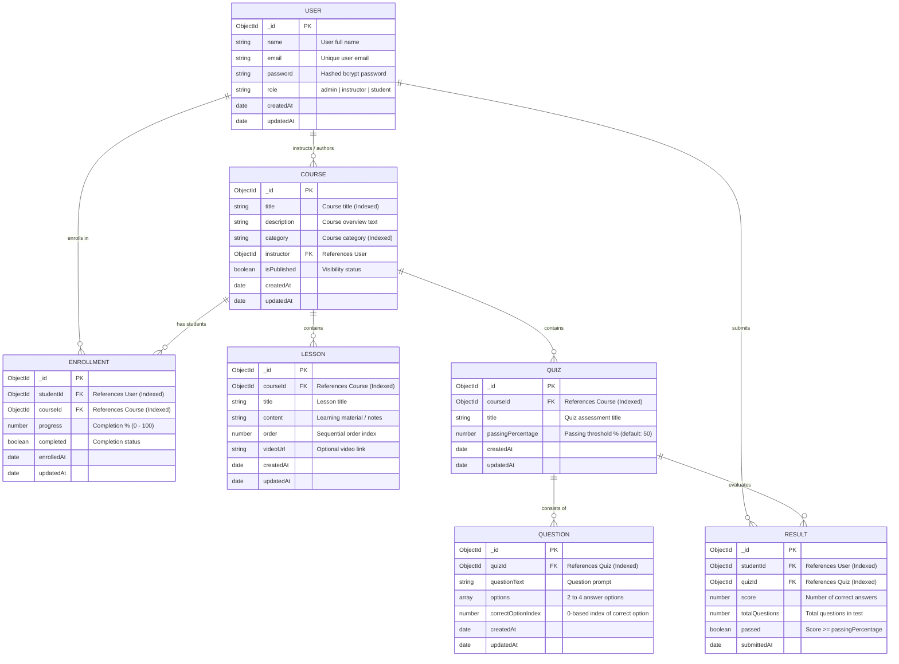

# Entity-Relationship (ER) Diagram - Basic LMS

This document details the database schema and entity relationships for the 7 core Mongoose models in the Basic Learning Management System: **User**, **Course**, **Lesson**, **Enrollment**, **Quiz**, **Question**, and **Result**.

---

## Entity Relationship Cardinalities

1. **User to Course (1:N)**:
   - One user with role `instructor` or `admin` can create and manage multiple `Courses`.
   - Each `Course` is authored by exactly one instructor (`instructor` FK).

2. **Course to Lesson (1:N)**:
   - A `Course` consists of zero or more sequential `Lessons`.
   - Each `Lesson` belongs to exactly one `Course`.

3. **User to Enrollment (1:N) & Course to Enrollment (1:N)**:
   - Composite relation: A student can enroll in multiple courses, and a course can have multiple enrolled students.
   - Compound index on `{ studentId: 1, courseId: 1 }` prevents duplicate enrollments.

4. **Course to Quiz (1:N)**:
   - A `Course` can offer multiple `Quizzes` (e.g., Weekly Quizzes, Midterms, Final Assessments).
   - Each `Quiz` belongs to one `Course`.

5. **Quiz to Question (1:N)**:
   - A `Quiz` has multiple multiple-choice `Questions`.
   - Each `Question` belongs to one `Quiz`.

6. **Quiz to Result (1:N) & User to Result (1:N)**:
   - When a student attempts a `Quiz`, a `Result` record is generated with their raw score, percentage, and pass/fail outcome.

