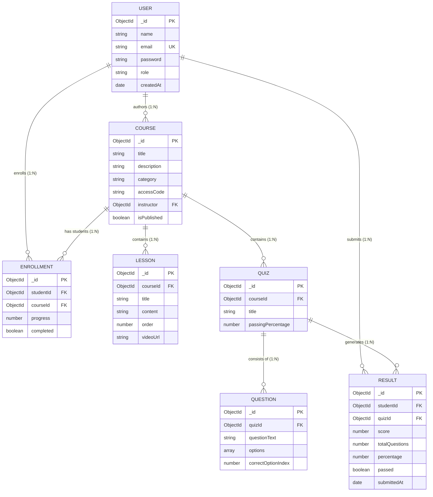

# College Project Submission Report: Basic LMS

**Project Number:** 4  
**Project Title:** Basic LMS (Learning Management System)  
**Target Roles:** Student, Instructor, Administrator  
**Architecture:** Full-Stack MERN (MongoDB Atlas + Express.js + React.js + Node.js 22)  
**Database:** MongoDB Atlas (Cloud Cluster) with Mongoose ODM  
**Frontend Framework:** React 18 with Vite, React Router DOM v6, Context API  
**Backend Framework:** Express.js 4, Modular Controllers, Routers & Middleware  
**Security:** JWT Authentication, Bcrypt.js Password Hashing, Role Middleware, Access Code Barrier  

---

## 1. Executive Summary & Project Scope

The **Basic LMS** is a full-featured web-based learning management system engineered to facilitate online education, course curriculum authoring, private student enrollment, interactive quizzes with automated grading, and real-time student progress tracking.

### Core Capabilities:
- **Course & Lesson Management:** Instructors create, publish, update, and manage modular courses with detailed text and video learning materials.
- **Access Code Protection System:** Courses are protected with instructor-generated Access Codes (e.g. `POTTER101`). Only authorized students with the code can view lessons, enroll, and take quizzes.
- **Interactive Assessments & Quizzes:** Quizzes with customizable passing thresholds, multiple-choice questions, randomized options, instant evaluation, and pass/fail indicators.
- **Student Progress Tracking:** Dynamic tracking of completed lessons with an animated visual progress bar and enrollment management.
- **Administrative Control Center:** User management, role promotions/demotions, sitewide enrollment tracking, and performance analytics.

---

## 2. Technical Stack & Architectural Design

### Frontend Architecture:
- **Build Tool:** Vite 5 (Fast ESM compilation)
- **Library:** React 18 (Functional components and React Hooks)
- **Routing:** `react-router-dom` v6 with role-based `ProtectedRoute` guards
- **State Management:** Native React Context API (`AuthContext`) for authentication state, user session persistence (`localStorage`), and access tokens.
- **Forms:** Controlled components utilizing `event.preventDefault()` and real-time validation.
- **Styling:** Custom modern CSS architecture with `Plus Jakarta Sans` and `DM Sans` typography, accessible contrast, responsive grid layouts, and custom status indicators.

### Backend Architecture:
- **Runtime:** Node.js 22
- **Server Framework:** Express.js with modular separation of concerns:
  - `/server/config`: Database connection (`db.js`)
  - `/server/models`: Mongoose schemas with indexes, pre-save hooks, and methods
  - `/server/controllers`: Business logic and HTTP handlers (`authController.js`, `courseController.js`, `lessonController.js`, `quizController.js`, `enrollmentController.js`, `reportController.js`)
  - `/server/middlewares`: JWT verification (`protect`) and role-based access control (`authorize`)
  - `/server/routes`: Express Routers mapping endpoints to controllers

---

## 3. Database Architecture & Mongoose Models

The database models are structured in MongoDB Atlas with foreign-key references (`ObjectId`), unique constraints, and compound indexes:

### 1. `User` Schema
- `_id`: ObjectId (Primary Key)
- `name`: String (Required, trimmed)
- `email`: String (Required, unique, lowercase, regex-validated)
- `password`: String (Hashed with bcryptjs 10 salt rounds; excluded by default with `select: false`)
- `role`: String (Enum: `'student' | 'instructor' | 'admin'`, default: `'student'`)
- `timestamps`: `createdAt`, `updatedAt`

### 2. `Course` Schema
- `_id`: ObjectId (Primary Key)
- `title`: String (Required, trimmed, indexed)
- `description`: String (Required)
- `category`: String (Required: `'Web Development'`, `'Data Science'`, `'Design'`, `'Business'`)
- `accessCode`: String (Uppercase, e.g. `'POTTER101'`; required to unlock course)
- `isPrivate`: Boolean (Default: `false`)
- `isPublished`: Boolean (Default: `true`)
- `instructor`: ObjectId (References `User`, required, indexed)
- `timestamps`: `createdAt`, `updatedAt`

### 3. `Lesson` Schema
- `_id`: ObjectId (Primary Key)
- `courseId`: ObjectId (References `Course`, required, indexed)
- `title`: String (Required, trimmed)
- `content`: String (Required learning material notes)
- `videoUrl`: String (Optional video lecture link)
- `order`: Number (Sequential ordering index, default: 1)
- `timestamps`: `createdAt`, `updatedAt`

### 4. `Enrollment` Schema
- `_id`: ObjectId (Primary Key)
- `studentId`: ObjectId (References `User`, required)
- `courseId`: ObjectId (References `Course`, required)
- `progress`: Number (Percentage from 0 to 100)
- `completed`: Boolean (Default: `false`)
- `timestamps`: `enrolledAt`, `updatedAt`
- *Index:* Compound unique index on `{ studentId: 1, courseId: 1 }` prevents duplicate enrollments.

### 5. `Quiz` Schema
- `_id`: ObjectId (Primary Key)
- `courseId`: ObjectId (References `Course`, required, indexed)
- `title`: String (Required quiz title)
- `passingPercentage`: Number (Default: 50, customizable threshold)
- `timestamps`: `createdAt`, `updatedAt`

### 6. `Question` Schema
- `_id`: ObjectId (Primary Key)
- `quizId`: ObjectId (References `Quiz`, required, indexed)
- `questionText`: String (Required question prompt)
- `options`: Array of Strings (2–4 multiple choice options)
- `correctOptionIndex`: Number (0-based index; hidden from students during test attempts)
- `timestamps`: `createdAt`, `updatedAt`

### 7. `Result` Schema
- `_id`: ObjectId (Primary Key)
- `studentId`: ObjectId (References `User`, required, indexed)
- `quizId`: ObjectId (References `Quiz`, required, indexed)
- `score`: Number (Count of correct answers)
- `totalQuestions`: Number (Total questions in assessment)
- `percentage`: Number (Calculated `(score / totalQuestions) * 100`)
- `passed`: Boolean (Calculated `percentage >= passingPercentage`)
- `submittedAt`: Date (Timestamp of submission)

---

## 4. Entity-Relationship (ER) Diagram

---

## 5. Compliance Verification: 8 Required Functional Works

| Item | Required Functional Work | Detailed Compliance Implementation |
|---|---|---|
| **1** | **Authentication** | Built with `bcryptjs` for salted password hashing and `jsonwebtoken` for issuing signed 7-day tokens. APIs protected by Bearer token headers. Includes auto-demo login helpers. |
| **2** | **Role Access** | Three distinct roles (`admin`, `instructor`, `student`). Middleware validates `req.user.role`. Frontend route guards prevent unauthorized navigation (e.g. students cannot access `/admin` or `/instructor/create-course`). |
| **3** | **Core Workflow** | Complete learning cycle: Course authoring $\to$ Access code distribution $\to$ Student code unlock $\to$ Course enrollment $\to$ Lesson completion tracking $\to$ Automated quiz grading $\to$ Results storage. |
| **4** | **Data Management** | Full CRUD implemented across all 7 Mongoose models: User management, Course creation/updates/deletion, Lesson authoring/ordering, Quiz authoring, and Submission tracking. |
| **5** | **List Features** | Dynamic regex title/topic search, category dropdown filter, sorting (Newest, Oldest, Title A-Z, Title Z-A), and paginated course grids. |
| **6** | **Validation** | Controlled forms in React enforce minimum password length (6 chars), required text, and valid email format. Express API validates request payloads before database operations. |
| **7** | **Feedback States** | User feedback on all actions: loading spinners during API operations, empty state notices on zero search results, dismissible error alerts on failure, and success banners on operations. |
| **8** | **Reports & Dashboard** | Centralized analytics endpoint (`/api/reports/summary`) generating live metrics: total student count, instructor count, active courses, enrollment completion rate, and overall quiz pass rate. |

---

## 6. Course Access Code Security System

To satisfy the requirement that **only authorized students with the code can view relevant courses and take quizzes**:
1. **Access Code Assignment:** Every course has an uppercase access code (e.g., `POTTER101`, `WEB2026`). Instructors can customize or auto-generate this code when creating a course.
2. **Access Code Portal:** The Courses catalog features an Access Code portal banner where students can enter their course code to reveal and unlock the course.
3. **Lock Barrier:** Private or code-protected courses display a `🔒 Code Protected` indicator. Attempting to view the course without the code presents a locked screen.
4. **Quiz Protection:** `GET /api/quizzes/:id` validates whether the student is enrolled or provided the matching code in the `x-access-code` header. Unauthorized requests are blocked with HTTP 403 Forbidden.

---

## 7. Pre-Configured Test Credentials

For evaluation and demonstration purposes, the system provides pre-configured test credentials for each of the three roles:

| Role | Email Address | Password | Permitted Actions |
|---|---|---|---|
| **Administrator** | `admin@lms.com` | `password123` | Full system control, role changes, course deletion, sitewide metrics |
| **Instructor** | `instructor@lms.com` | `password123` | Create courses, configure access codes, publish lessons, build quizzes |
| **Student** | `student@lms.com` | `password123` | Enter access code (`POTTER101`), enroll in courses, attempt quizzes |

*(Tip: The Sign In page features 1-click Quick Demo buttons for each of these three roles.)*

---

## 8. RESTful API Endpoints Summary

| Method | Endpoint | Access | Description |
|---|---|---|---|
| `POST` | `/api/auth/register` | Public | Register new user account |
| `POST` | `/api/auth/login` | Public | Authenticate user & issue JWT token |
| `GET` | `/api/auth/me` | Private | Get authenticated user profile |
| `GET` | `/api/auth/users` | Admin | Get paginated list of users |
| `PUT` | `/api/auth/users/:id/role` | Admin | Update user role |
| `DELETE` | `/api/auth/users/:id` | Admin | Delete user account |
| `GET` | `/api/courses` | Public | Get courses with search, filters & pagination |
| `POST` | `/api/courses/verify-code` | Public | Verify course access code |
| `GET` | `/api/courses/:id` | Public | Get course details by ID |
| `POST` | `/api/courses` | Instructor / Admin | Create a new course with access code |
| `PUT` | `/api/courses/:id` | Instructor / Admin | Update course details or access code |
| `DELETE` | `/api/courses/:id` | Instructor / Admin | Delete course |
| `GET` | `/api/lessons/course/:id`| Enrolled / Code | Get lessons for a course |
| `POST` | `/api/lessons` | Instructor / Admin | Create a new lesson |
| `PUT` | `/api/lessons/:id` | Instructor / Admin | Update lesson content or order |
| `DELETE` | `/api/lessons/:id` | Instructor / Admin | Delete lesson |
| `GET` | `/api/quizzes/course/:id`| Enrolled / Code | Get quizzes for a course |
| `GET` | `/api/quizzes/:id` | Enrolled / Code | Get quiz questions (answers hidden for students) |
| `POST` | `/api/quizzes` | Instructor / Admin | Create quiz with multiple choice questions |
| `POST` | `/api/quizzes/submit` | Private | Submit quiz answers & calculate score |
| `GET` | `/api/quizzes/results/my`| Student | Get current student's quiz results |
| `GET` | `/api/enrollments/my` | Student | Get enrolled courses with progress % |
| `POST` | `/api/enrollments/enroll` | Student | Enroll in course with access code |
| `DELETE` | `/api/enrollments/:id` | Student | Unenroll / drop course |
| `PUT` | `/api/enrollments/progress`| Student | Update lesson progress percentage |
| `GET` | `/api/reports/summary` | Admin / Internal | Sitewide summary statistics & analytics |

---

## 9. Submission Deliverables Checklist

- [x] **Source Code Repository:** Clean React 18 + Node.js 22 codebase.
- [x] **Environment Configuration:** `.env` and `.env.example` with MongoDB Atlas and JWT secrets.
- [x] **Postman Collection:** `postman_collection.json` containing test requests for all endpoints.
- [x] **ER Diagram Document:** `docs/ER_DIAGRAM.md` with Mermaid diagram and cardinality notes.
- [x] **Project Documentation Report:** `docs/PROJECT_REPORT.md` (this comprehensive document).
- [x] **README Instructions:** `README.md` with local setup, run scripts, and role guide.
- [x] **Access Code Feature:** Functional access code gatekeeping for private courses and quizzes.
